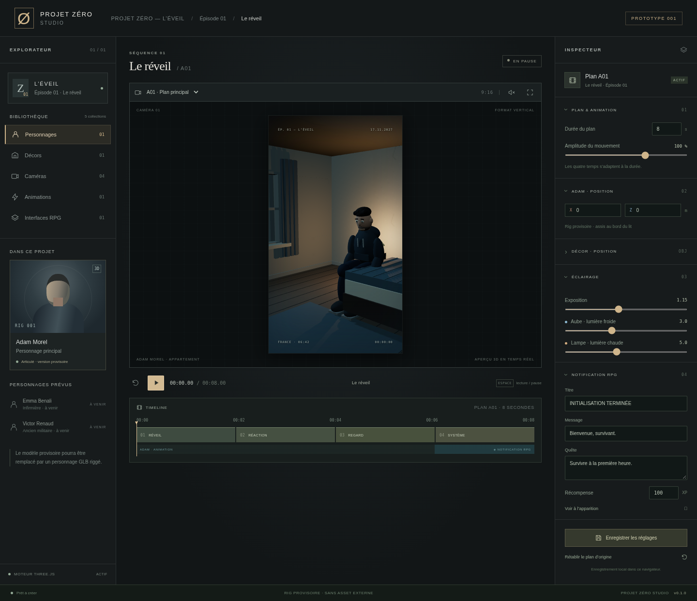

# PROJET ZÉRO STUDIO · Prototype 001

Atelier web 3D pour **PROJET ZÉRO — L’ÉVEIL**, une série originale de survie en France.
Le premier plan, **A01 · Le réveil**, dure 8 secondes au format vertical 9:16.
Application locale en Three.js, Vite et JavaScript, sans compte, clé API ni service payant.



## Lancer

Prérequis : **Node.js 24** recommandé, navigateur récent avec WebGL 2 et accélération graphique.
Aucune installation sur un ordinateur professionnel n’est requise pour développer dans le cloud.
Les commandes suivantes sont à exécuter dans le terminal de l’environnement de développement,
à la racine de `Projet-zero` :

```sh
npm ci
npm run dev
```

Ouvrir l’adresse indiquée par Vite **sur la machine qui exécute le serveur**, ou le port
5173 via l’outil de transfert de ports de votre environnement cloud s’il en propose un.
Pour Windows, si Node est déjà disponible, les mêmes commandes fonctionnent dans PowerShell.
Sinon utiliser un environnement cloud autorisé ; aucune autorisation administrateur n’est nécessaire
pour ce projet et il ne faut pas modifier la configuration du poste professionnel.
Cette session d’onboarding ne fournit pas de lien public interactif : les captures dans `docs/`
sont des aperçus fixes du prototype exécuté, pas un hébergement.

```sh
npm run build       # résultat statique dans dist/
npm run preview     # vérifier le build sur le port 4173
npm test            # timeline et chemins d’assets, 10 tests
```

`dist/` doit être servi par HTTP, pas ouvert directement avec un double-clic sur index.html.
Sur un téléphone, utiliser une URL HTTPS de déploiement statique ou un port cloud partagé
via les fonctions autorisées de l’hébergeur. Ne pas désactiver les règles du réseau professionnel.
Le build utilise le chemin `/Projet-zero/`, configuré dans `vite.config.js`.
Les serveurs Vite de développement et de prévisualisation utilisent également ce préfixe.

## Publier gratuitement sur GitHub Pages

GitHub Pages héberge gratuitement ce studio statique pour un dépôt public, sans API,
serveur applicatif ni compte chez un service tiers. L’adresse prévue, **après le premier
déploiement réussi**, est :

**https://skhodripromojcurie.github.io/Projet-zero/**

1. Dans le dépôt GitHub, ouvrir **Settings → Pages → Build and deployment** et choisir
   **GitHub Actions** comme **Source**. Ne pas sélectionner un dossier de branche `docs`.
   Ce réglage doit être activé avant le premier déploiement.
2. Fusionner la PR #1 du prototype dans `main`, puis la PR dédiée à GitHub Pages.
   La branche Pages part du prototype ; elle ne remplace pas la PR #1.
3. Ouvrir **Actions → Déployer le studio sur GitHub Pages**. Après chaque push sur `main`,
   le workflow installe les dépendances verrouillées, exécute les tests, compile Vite,
   teste la version compilée sous `/Projet-zero/`, puis publie uniquement `dist/`.
4. Une fois le workflow réussi, retrouver le lien dans **Settings → Pages**, dans
   l’environnement **github-pages**, ou dans le résumé du job de déploiement.
   Ouvrir cette adresse sur ordinateur ou téléphone, sans installer Node.js.

Si Pages a été activé après un premier échec, ouvrir le workflow dans **Actions**,
cliquer **Run workflow**, sélectionner **main**, puis relancer. Un lancement manuel
sur une autre branche est ignoré : les branches de travail ne publient pas le site.
Les tests de PR restent dans le workflow séparé « Vérification du prototype ».
Les permissions de publication (`pages: write`, `id-token: write`) sont limitées au
job de déploiement ; aucun secret à créer et aucune branche `gh-pages` à gérer.

Un lien ne fonctionne qu’après activation de Pages et déploiement réussi. Les tests
locaux n’établissent pas que GitHub a déjà publié le site. Si un déploiement échoue,
consulter le premier job rouge dans **Actions** ; après correction, le relancer depuis
`main`. Le workflow refuse de déployer si la compilation ou un test échoue.

### Chemins des futurs modèles GLB/GLTF

Placer les modèles vérifiés dans `public/assets/models/`. Par exemple,
`public/assets/models/adam.glb` sera disponible à
`/Projet-zero/assets/models/adam.glb`. Le chargeur existant applique automatiquement
`import.meta.env.BASE_URL` avec `publicAssetUrl` :

```js
const adam = await loadRiggedCharacter("assets/models/adam.glb");
```

Pour un autre chargement public (`fetch`, texture, audio), utiliser
`publicAssetUrl("assets/...")` depuis `src/assets/paths.js`, plutôt qu’un chemin
codé en dur à la racine du domaine. Vite traite déjà les imports JavaScript/CSS.
Conserver les fichiers `.bin` et textures d’un GLTF dans leur arborescence relative
au modèle ; `GLTFLoader` résout leurs chemins depuis l’URL du modèle. Respecter la
casse des noms sur GitHub Pages. Aucun modèle supplémentaire n’est ajouté ici.

Pour vérifier la version compilée avant publication :

```sh
npm run build
npm run preview
```

Ouvrir l’adresse de prévisualisation indiquée par Vite, suivie de `/Projet-zero/` si
le terminal n’affiche que le domaine. Les tests navigateur ci-dessous contrôlent
également les scripts, styles et fichiers publics sous ce chemin.

## Ce qui fonctionne

- Appartement en composants indépendants : lit, chevet, réveil **06:42**, fenêtre donnant
  sur une rue, porte et commode. La porte est fermée ; le couloir n’est pas encore modélisé.
- Adam provisoire articulé, sweat anthracite, jean sombre, cheveux bruns et barbe simplifiée.
- Quatre cadrages fixes : plan principal, visage, fenêtre et porte.
- Lecture, pause, reprise, retour au début, recherche temporelle et arrêt à la fin.
  La touche Espace contrôle la lecture hors champs et boutons.
- Les poses et l’interface dépendent uniquement du temps : retrouver la même seconde
  donne la même image, sans mouvement aléatoire ni changement de visage.
- Lumière froide, lampe chaude et exposition ajustables.
- Position d’Adam relative au lit, déplacement du lit avec Adam et du chevet avec sa lampe.
- Durée de 4 à 16 secondes et amplitude ajustables. Les quatre temps sont proportionnels.
- Notification RPG HTML/CSS éditable (titre, message, quête, XP), apparition au dernier quart.
  La bibliothèque RPG présente aussi santé, endurance, caractéristiques, compétences et menace.
- Bibliothèque par collections, inspecteur, vue plein écran et interface mobile.
- Sauvegarde locale des réglages et rechargement automatique dans le même navigateur.
  Elle ne se synchronise pas entre appareils et ne remplace pas un fichier projet.
- Bouton son : **cri synthétique provisoire**, désactivé par défaut. Il se déclenche en lecture,
  au début du deuxième temps. Pause, recherche et retour au début l’interrompent.

| Temps d’origine | Action                                            |
| --------------- | ------------------------------------------------- |
| 0–2 s           | Adam redresse légèrement la tête                  |
| 2–4 s           | Il réagit au cri lointain                         |
| 4–6 s           | Il tourne progressivement la tête vers la fenêtre |
| 6–8 s           | Il fixe la fenêtre, la notification apparaît      |

## Limites assumées

C’est un **prototype fonctionnel et un animatique en primitives**, pas un personnage
semi-réaliste fini. La géométrie et le visage restent visiblement simplifiés ; pas de
vêtements simulés, de véritable rig facial, de lip-sync ou de mocap. L’éclairage n’a pas
de ray tracing, de profondeur de champ ni d’étalonnage de production. Le cri est un repère
sonore de synthèse, pas un enregistrement réaliste. Le fond de rue est sommaire.

Emma et Victor sont des entrées de préparation explicitement indisponibles. Les stats RPG
sont des valeurs narratives initiales, sans système de combat ni simulation de progression.
L’inspecteur fournit des réglages ciblés ; ce n’est pas encore un éditeur 3D généraliste.
Pas d’export vidéo, montage multi-plan, import GLB par interface ni sous-titres pour l’instant.
Le module GLB est une base d’adaptation, pas un remplacement automatique déjà validé avec un asset.
Les performances dépendent du GPU ; la résolution est plafonnée à un ratio de pixels de 1,75.

## Architecture

```text
src/
  assets/paths.js             chemins publics adaptés à GitHub Pages
  animations/timeline.js      poses absolues et interpolation
  cameras/presets.js          cadrages fixes
  characters/adam.js          rig procédural provisoire
  characters/gltf.js          base d’adaptateur pour un futur GLB licencié
  environments/apartment.js  décor et éclairage
  environments/objects.js    composants et textures procédurales
  scenes/a01.js              composition et rendu
  scenes/config.js           réglages bornés et registre des personnages
  ui/                        studio, bibliothèque, audio, icônes
  main.js                    transport, édition, stockage local
public/assets/               emplacement prévu pour les assets futurs
```

Un personnage expose `root` et `applyPose(pose, config, time)`. Le remplacement d’Adam
par un GLB conservera la scène et la timeline, mais demandera une correspondance de clips,
une échelle, une orientation et un adaptateur de rig facial propres au modèle.
Ne télécharger aucun asset avant vérification de sa licence commerciale. Voir
[AGENTS.md](AGENTS.md) et [THIRD_PARTY_NOTICES.md](THIRD_PARTY_NOTICES.md).

## Tests navigateur

```sh
npx playwright install chromium
npm run test:e2e
```

Dans cet environnement cloud, Chromium est déjà installé :

```sh
CHROMIUM_PATH=/usr/bin/chromium npm run test:e2e
```

Dans PowerShell avec un Chromium système : `$env:CHROMIUM_PATH = 'chemin-vers-chrome.exe'`.
Playwright démarre Vite lui-même. Il vérifie WebGL, lecture/pause/fin, quatre caméras,
réglages persistés, textes sans interprétation HTML, reproductibilité des images,
plein écran, son et usage téléphone. Les captures du dernier test sont dans `artifacts/`.
Les captures de référence de `docs/` ne sont pas des comparaisons pixel à pixel entre GPU.
La CI exécute compilation, tests unitaires et tests navigateur sous `/Projet-zero/`.
Les tests de chemins comprennent le chargement HTTP d’un GLB minimal généré pendant
le test, sans modèle humain ni asset externe. Le résultat distant de la CI reste à
vérifier sur la pull request.

Pour exécuter les tests navigateur contre le build compilé dans le cloud :

```sh
npm run build
STUDIO_PREVIEW=1 CHROMIUM_PATH=/usr/bin/chromium npm run test:e2e
```

Dans PowerShell : définir `$env:STUDIO_PREVIEW = '1'` avant `npm run test:e2e`.
Arrêter d’abord un éventuel serveur de développement sur le port 5173 pour que le
serveur de prévisualisation teste bien `dist/`.

## Prochaines priorités

1. Choisir un modèle humain riggé à licence commerciale gratuite, améliorer son visage
   et adapter les poses A01 sans changer la composition des scènes.
2. Améliorer les matériaux et les ombres ; vérifier les performances sur le téléphone cible.
3. Ajouter une sauvegarde/importation de fichiers projet, puis plusieurs plans et scènes.
4. Préparer un export vidéo qui compose aussi l’interface HTML, l’audio et les sous-titres.
   Une capture du canvas seule ne contient pas la notification HTML.
