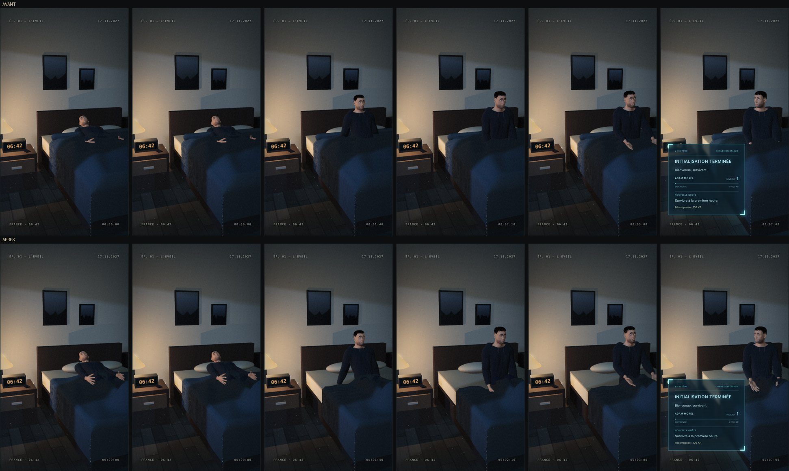
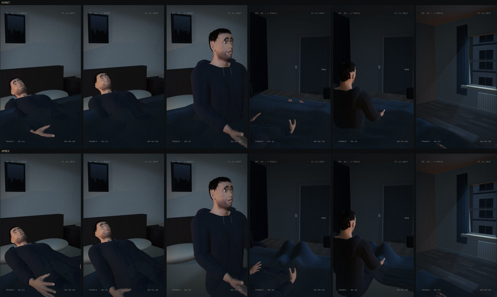

# Plan A01 · couette drapée autour d'Adam

## Le problème

L'ancienne couette était une surface figée, réglée pour le rig procédural. Avec
`Adam_Morel.glb`, le corps la traversait :
- couché, Adam était enfoui sous une nappe plate dont seules les mains dépassaient ;
- assis, son torse sortait tout droit de la surface ;
- ses mains et ses pieds s'y enfonçaient.

L'animation inclinait aussi les jambes de 9° vers le bas. Ses chevilles finissaient
dans le matelas, ce qui ne se voyait pas sous l'ancienne couette.

## La correction

Ce n'est pas une simulation physique, mais un drapé calculé à chaque image à partir
de la pose (`src/environments/duvet.js`). L'image reste une fonction pure du temps :
même instant, même couette.

- **Volume** : la couette épouse des volumes simples posés sur les articulations du
  personnage (bassin, cuisses, jambes, pieds, et torse tant qu'il est couché), avec
  un rembourrage de 3 cm. Elle ne passe jamais sous la surface de ces volumes.
- **Affaissement** : loin du corps, elle retombe à plat sur le matelas ; sur les
  bords, elle tombe du lit.
- **Appuis** : sous les bras et les mains, elle s'enfonce, jusqu'au drap sous une
  main qui pousse.
- **Redressement** : quand Adam s'assoit, le haut de la couette glisse jusqu'à ses
  genoux, avec un ourlet roulé et des plis de tassement. Le torse sort du drapé
  progressivement, sans saut.
- **Plis** : bruit doux et longs plis fixes. Ils sont déterministes.
- **Jambes** : elles reposent maintenant à plat sur le matelas, et les genoux se
  plient un peu quand Adam s'assoit (`src/animations/a01.js`).

Pour lire la pose, les adaptateurs de personnage exposent `jointPosition(nom, cible)`.
Le rig procédural et les GLB le font de la même façon : la scène ne dépend toujours
pas du rig interne.

## Avant / après

Plan principal à 0 ; 0,8 ; 1,4 ; 2,1 ; 3 et 7 s :

Autres caméras (visage, porte, fenêtre) :

## Vérifié

- `npm test` : 22/22, dont 4 nouveaux tests :
  - la couette ne passe jamais sous le corps ;
  - elle est une fonction pure de la pose ;
  - son ourlet suit le redressement ;
  - les mains l'enfoncent.
- `npm run test:e2e` : 15/15 dans Chromium.
- `npm run build` réussit.
- Captures de toutes les caméras. Cadrages, lumière et apparence d'Adam sont inchangés.

## Limites

- Ce n'est pas un tissu simulé : les plis ne réagissent pas aux mouvements rapides.
  Le drapé suit la pose.
- Les volumes sont approximatifs. Vu de très près, la couette peut flotter de
  quelques centimètres au-dessus des jambes.
- La texture glisse avec le tissu quand la couette descend sur les genoux.
