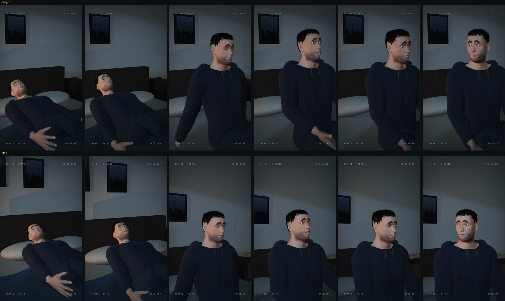
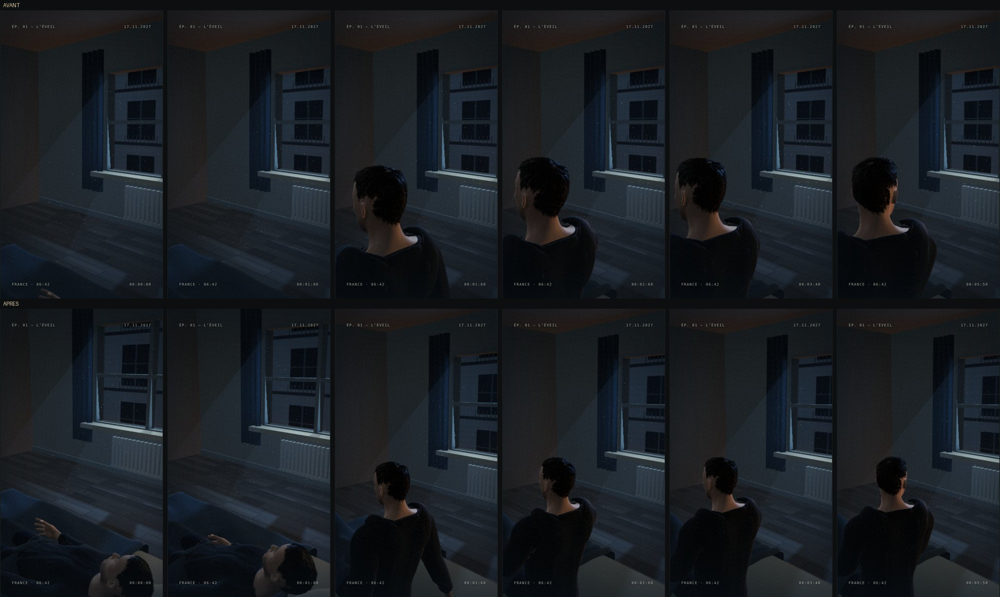

# Plans A02 et A03 · cadrages corrigés

A02 (visage) et A03 (fenêtre) sont deux caméras de la même scène de 8 s que A01.
L'audit sur toute la durée du plan avait relevé :

- **A02 · Visage d'Adam** : la caméra était fixe. Couché, Adam était en bas à gauche ;
  redressé, le haut du crâne frôlait le bord du cadre. Dès qu'il tourne la tête vers
  la fenêtre, le visage tombait dans la pénombre.
- **A03 · La fenêtre** : pendant la première seconde, le cadre était vide, à part une
  main isolée dans un coin. Ensuite, la nuque d'Adam, très proche, occupait la
  moitié de l'image.

## Corrections

- **Cadrage qui suit la tête** : un préréglage de caméra peut déclarer `follow`, de
  0 à 1. La visée se décale alors vers la tête d'Adam, lue à chaque image avec
  `jointPosition("head")`. C'est une fonction de la pose, donc du temps : même
  instant, même cadre.
  - A02 suit à 80 % : le visage reste centré, couché comme assis.
  - A03 suit à 45 %, et la caméra recule un peu, plus haut (fov 48). Couché, Adam
    occupe le premier plan sous la fenêtre ; assis, c'est un plan par-dessus l'épaule
    vers la fenêtre.
- **Lumière de visage** (`faceFill`, A02 seulement) : un remplissage froid et doux,
  motivé par l'aube à la fenêtre. Il est placé entre la caméra et la tête, côté
  fenêtre, et son intensité suit le réglage « Aube · lumière froide ».
- **A01 et A04** ne changent pas : ni suivi, ni lumière ajoutée.

## Avant / après

## Vérifié

- `npm test` : 24/24, dont 2 nouveaux tests :
  - seules les caméras avec `follow` suivent la tête ;
  - le cadrage suivi est une fonction pure de la position de la tête.
- `npm run test:e2e` : 15/15, dont le test de déterminisme sur A02 (même instant,
  même image).
- `npm run build` réussit.

## Limites

- Vus de dos, les cheveux en cartes restent un peu en paquets ; la caméra plus
  éloignée les atténue.
- La notification RPG, fixe dans l'interface, recouvre une partie d'Adam en fin de
  plan sur A02 et A03.
