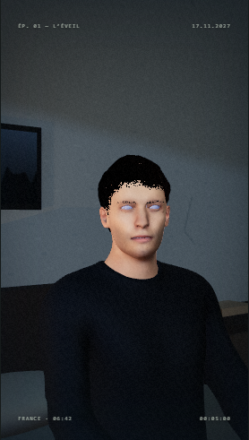
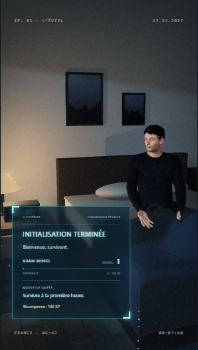
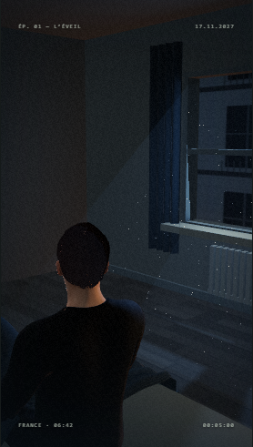

# Adam candidat : essai réversible

Branche `integration/adam-candidat`, issue du commit `5355bd7` de la PR #9.
Au contrôle GitHub du 22 octobre 2026, #8 et #9 sont ouvertes, non fusionnées.
#8 cible main ; #9 cible `claude/projet-zero-a01-couette`. Conserver cet ordre
de dépendance. Aucune fusion n'est autorisée par cet essai.

## Fichier retrouvé

Le fichier provient du dossier local `Adam-Morel/livraison/Adam_Morel_candidat.glb`.
Sa source Blender est `Adam-Morel/livraison/Adam_Morel_candidat.blend` ; la source
détaillée est `Adam-Morel/v2/Adam_Morel_v2.blend`. Ces sources restent hors dépôt.
Les versions initiale et v2 existent aussi, mais seul le candidat livré est essayé.

Empreinte SHA-256 du GLB copié sans modification :
`3383b8cdd90817aae2b5455b0b987d5bf48b911ef01ccdc994e801286f0e7e11`.

| Mesure du fichier | Adam actuel | Candidat |
| --- | --- | --- |
| Octets | 4 194 140 | 11 224 636 |
| Triangles | 66 921 | 38 166 |
| Os du skin | 55 | 53 |
| Expressions distinctes | 10 | 0 |
| Clips | 0 | 0 |
| Images intégrées | 5 WebP | 9 PNG |

Les deux GLB embarquent leurs ressources, sans URI externe. Le candidat est
moins dense mais plus lourd à télécharger. Le rapport Blender de livraison
mesure environ 1,816 m : ne pas supposer l'échelle identique au modèle actuel.

## Pipeline et retour arrière

Lancer le studio puis ouvrir `/Projet-zero/?adam=candidat`. Sans ce paramètre,
le modèle actuel reste déclaré sous `adam` et chargé comme avant. Le candidat
est une seconde entrée `adam-candidat` du même manifeste. Retirer le paramètre
et recharger restaure immédiatement l'actuel ; aucun réglage n'est persisté.
Le repli procédural existant reste disponible en cas d'échec du chargement.

`GLTFLoader` charge le GLB par `publicAssetUrl`, compatible avec la base Pages.
Le profil `mpfb` convertit les 19 articulations du vocabulaire normalisé,
redresse les membres de la pose de repos puis applique les rotations absolues
du plan. Le contrat reste `root`, `applyPose` et `jointPosition`. Cette dernière
méthode alimente le drapé de #8 et le suivi de tête de #9.
L'absence de clips utilise le mode articulations ; les poses de la scène et
la respiration sont conservées. Les clignements, expressions et mouvements
des yeux sont indisponibles sur ce candidat. Le statut de l'essai le précise.

Les premières captures Three.js ont révélé des taches sur le visage : les
matériaux peau, lèvres, ongles, oreilles, yeux et dents sont exportés en BLEND.
Le champ optionnel `opaqueMaterials` les rend opaques, uniquement sur le
candidat. Les cheveux et sourcils utilisent `alphaHash`, déjà pris en charge.
Le binaire et le modèle par défaut sont conservés sans modification.

## Provenance

`preuves-licences.json` reprend les en-têtes CC0 des assets MakeHuman locaux.
Les neuf chemins sources étaient accessibles et leurs empreintes correspondaient
aux preuves au moment de l'inspection. Le dossier de livraison attribue les
modifications et textures originales à Projet Zéro sous CC0. Aucun asset externe
n'a été téléchargé pour cette intégration.

## Vérifications des plans

Le studio implémente une scène de réveil A01, avec quatre presets de caméra
étiquetés A01 à A04. Ce ne sont pas neuf scènes déjà disponibles.

| Vue demandée | Couverture préparée |
| --- | --- |
| A01 principal | Captures 0, 1, 2, 3, 5, 7,6 s ; corps et couette |
| A02 visage | Mêmes instants ; cadrage, peau, lumière ; visage sans expressions |
| A03 fenêtre | Mêmes instants ; tête, épaules et orientation |
| A04 porte | Mêmes instants ; silhouette et contacts lit/couette |
| A05 | Absent : aucune scène ni caméra correspondante |
| A06 | Absent : aucune scène ni caméra correspondante |
| A07 | Absent : aucune scène ni caméra correspondante |
| A08 | Absent : aucune scène ni caméra correspondante |
| A09 | Absent : aucune scène ni caméra correspondante |

`tests/browser/adam-candidat.spec.js` vérifie le chargement, les 19 articulations,
l'absence d'expressions, le changement de pose et la reproduction exacte de
l'image à t=0 après retour depuis 7,6 s, pour chacune des quatre caméras.
Les captures sont dans `artifacts/adam-candidat/` (ignoré par Git).
Une image différente ne garantit pas l'absence de collisions : examiner les
captures avant une adoption du modèle, notamment mains, sweat, genoux et couette.
A05–A09 nécessitent leurs scènes/cadrages ou le brief correspondant.

La validation artistique, les performances sur carte graphique réelle et
l'équivalence des expressions restent ouvertes. Cet essai n'est pas un
remplacement définitif et ne publie rien sur GitHub Pages.

## Résultats constatés

- 24/24 tests unitaires ; compilation Vite réussie (avertissement de taille du bundle).
- 16/16 tests Chromium, dont le nouveau contrôle candidat ; ce contrôle a été
  relancé après la correction des matériaux : réussite et captures renouvelées.
- Les taches de tri de transparence du visage disparaissent après correction.
- Les yeux paraissent très clairs et le bord des cheveux/sourcils reste tramé.
  Ce rendu n'est donc pas validé pour un remplacement définitif.
- Les vues A01–A04 donnent un corps cadré, couché puis assis ; aucune garantie
  exhaustive de non-intersection des vêtements ne découle des tests d'image.
- Rendu Chromium logiciel : aucune mesure de fluidité sur GPU réel revendiquée.

