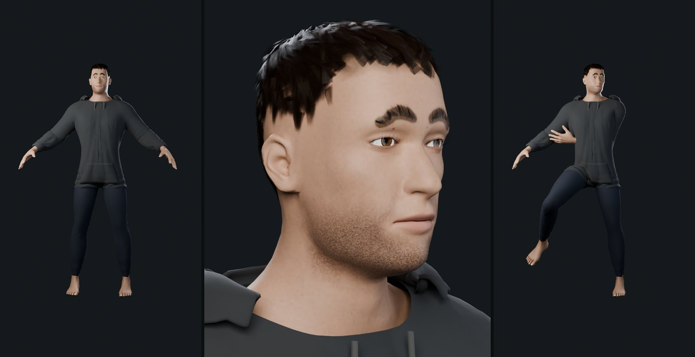
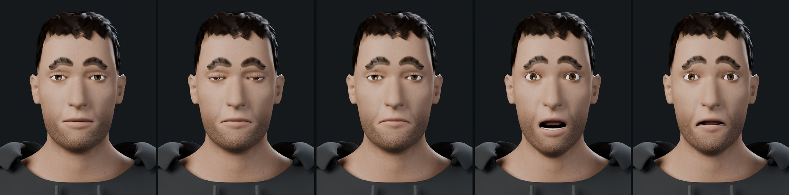
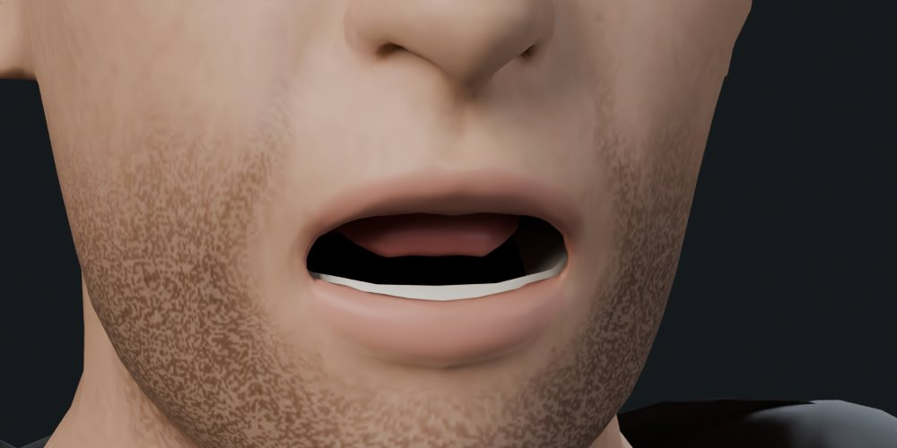
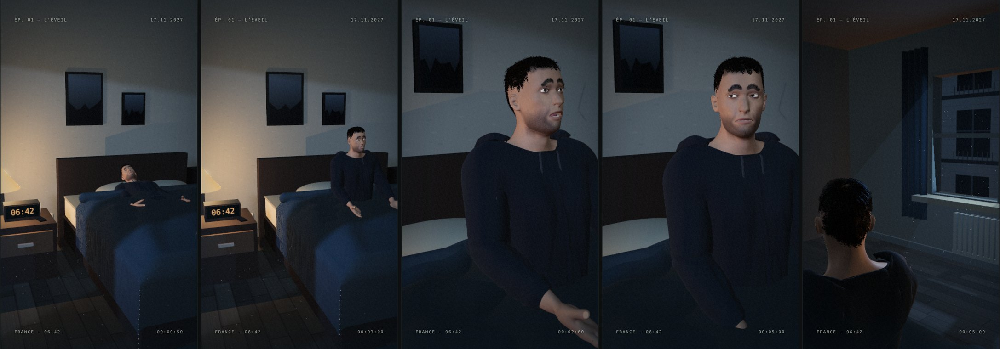
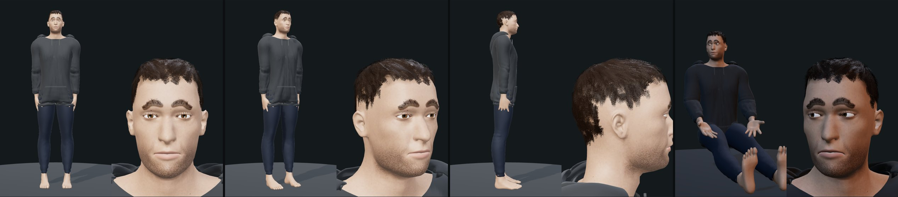

# Lot 3 · Adam Morel définitif (variante A) dans le studio

Visage validé : **variante A, sans retouche**. Ses valeurs sont figées dans
`tools/mpfb/adam_recette.json` (`"variante_retenue": "A"`, version 2 de la recette).
Le fichier `public/assets/models/Adam_Morel.glb` en est issu et **remplace le rig
procédural dans le plan A01**. Le rig procédural reste en secours si le fichier manque
ou est refusé.

## Fabrication, sans modélisation manuelle

Une commande (`tools/mpfb/construire_adam.py`, ou `construire_adam.bat` sous Windows)
rejoue toute la chaîne depuis la recette, en 3 à 4 minutes dans le cloud :

1. **MPFB 2** : corps, visage A, taille de 1,78 m, peau et yeux bruns.
2. **Pilosité** : cartes de cheveux courts, sourcils et cils (`pilosite.py`).
3. **Expressions** : 10 canaux ARKit issus des unités MPFB ; sourcils et cils les suivent.
4. **Squelette** « game engine » (53 os), plus deux os `eye_l` et `eye_r` pour le regard.
5. **Bouche** : dents et langue tirées de la géométrie d'aide MakeHuman ; la mâchoire
   inférieure suit `jawOpen`.
6. **Peau en textures** : la peau procédurale est cuite en image 2048 px. La barbe, le
   cuir chevelu et la base des sourcils y sont **peints** (`peinture.py`). Dans le
   navigateur, cela rend mieux qu'une couche transparente.
7. **Habillage** du lot 2, sans changement : sweat anthracite, jean sombre, simulation
   de tissu, capuche, poche, cordons.
8. **Export** : vêtements allégés, textures WebP, GLB unique.

`rendus_final.py` produit ensuite les rendus de contrôle **à partir du GLB exporté**.

## Le fichier

| Mesure | Valeur |
| --- | --- |
| Poids | 4,0 Mo (budget : 15 Mo) |
| Triangles | 66 921 : cheveux 19 600, corps 20 800, sweat, capuche et poche 14 886, jean 5 223, sourcils 2 880, autres 3 532 |
| Squelette | 55 os ; les 19 articulations du studio sont reconnues (profil `mpfb`) |
| Expressions | 10 : clignements, yeux écarquillés, sourcils, mâchoire, coins de la bouche |
| Textures | peau 2048², yeux 1024², mèches 256×512, sourcils 64×128, cils 64×64 (WebP) |
| Hauteur | 1,79 m, cheveux compris (corps : 1,78 m) |

## Captures réelles

Rendus Cycles du GLB : en pied, portrait, pose de contrôle du squelette.

Expressions : neutre, fatigue, inquiétude, surprise, peur.

Studio, rendu WebGL dans Chromium. Plan A01 : couché, redressement, surprise au cri,
inquiétude et regard de côté, vue de dos vers la fenêtre.

Évaluateur du studio : en pied, gros plan, profil, pose du plan sous la lumière d'A01.

## Ce qui a été testé dans le cloud

- Construction complète depuis la recette, dans Blender 5.0.1 avec MPFB 2.0.18.
- GLB inspecté : poids, triangles, squelette, expressions, textures.
- Rendus Cycles du GLB réimporté : expressions, bouche ouverte, pose du squelette.
  Les vêtements et la tête suivent les os.
- Studio (Chromium) : chargement par le manifeste, plan A01 complet, regard par les os
  des yeux, expressions, affichage téléphone, version compilée (`STUDIO_PREVIEW=1`).
  Le plan reste déterministe : même instant, même image.
- `npm test` : 18/18. `npm run test:e2e` : 15/15, dont un nouveau test de chargement
  d'Adam_Morel.glb.

## À vérifier sur votre PC

- **Le studio sur votre navigateur et votre carte graphique**. Les captures viennent
  d'un rendu logiciel (SwiftShader) : fluidité et finesse réelles restent à voir.
- **`construire_adam.bat` avec Blender 5.2.2 et votre MPFB**. Il n'a pas été lancé sur
  Windows. Il doit refaire le même Adam : même recette, mêmes graines.
- **GitHub Pages après fusion** : la version compilée est testée, pas encore publiée.

## Limites restantes

- **Rendu animatique, pas photoréaliste.** Dans le navigateur, la peau n'a ni
  diffusion sous la peau ni pores. Elle reste plus lisse et plus pâle que dans Cycles.
- **Cheveux en cartes.** Ils sont tramés dans le navigateur, ce qui donne un léger grain
  de près. La ligne frontale reste un peu dentelée.
- **Bouche ouverte, version minimale.** Les dents et la langue sont simples, les dents du
  haut sont peu visibles, et l'intérieur de la bouche est noir, sans gencives modelées.
- **Vêtements du lot 2.** La capuche fait de petites pointes sur les épaules. Adam est
  pieds nus, sans chaussures ni chaussettes.
- **66 921 triangles**, au-dessus du budget conseillé de 20 000 à 40 000. Le studio
  reste fluide en test, mais il faudra mesurer sur téléphone.
- **Pas de clips d'animation.** Le plan pilote directement les os (mode « pose »).
- **Les expressions déforment le visage, pas les cheveux.** Les sourcils et la barbe
  peints suivent la peau ; les mèches suivent la tête.
